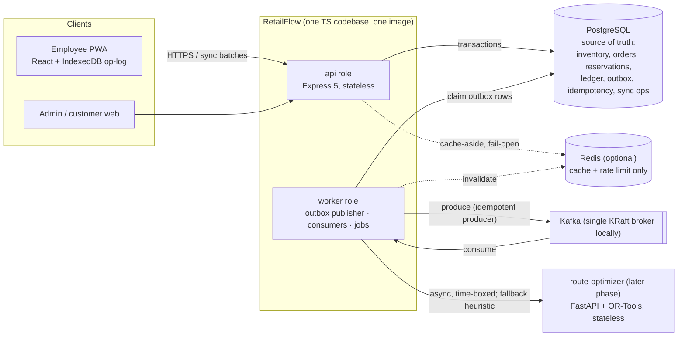
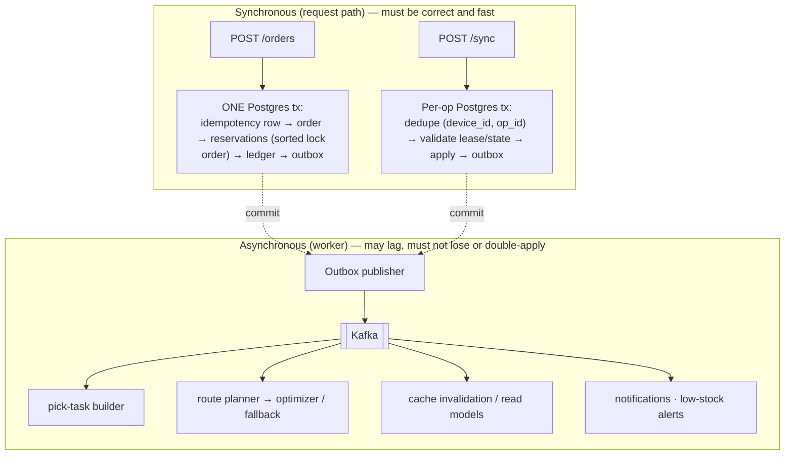
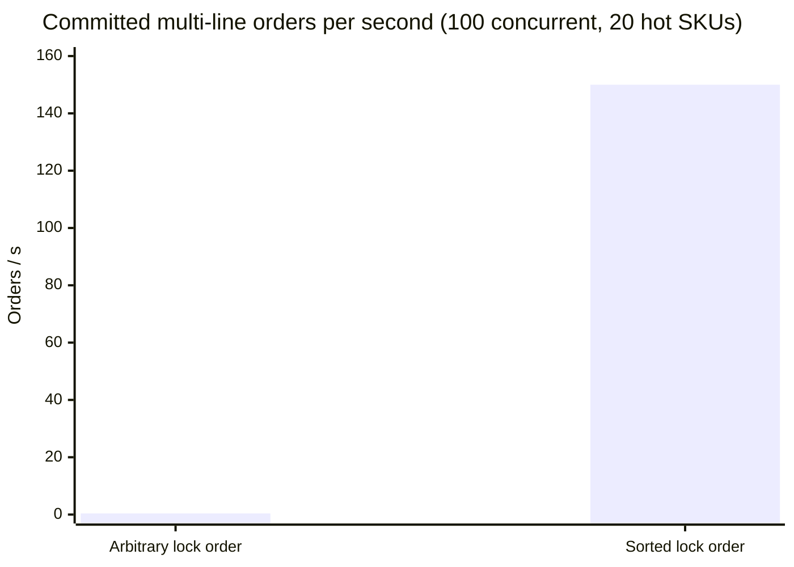
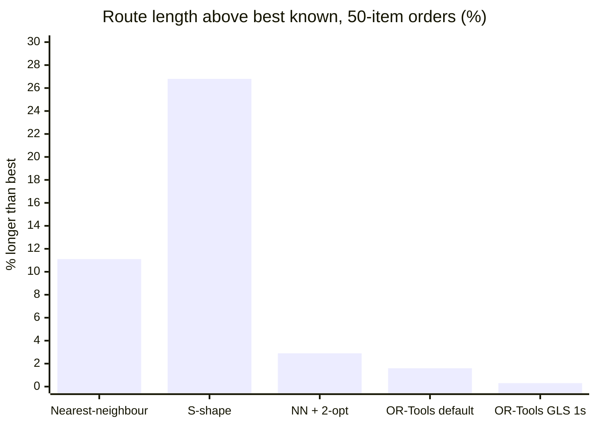
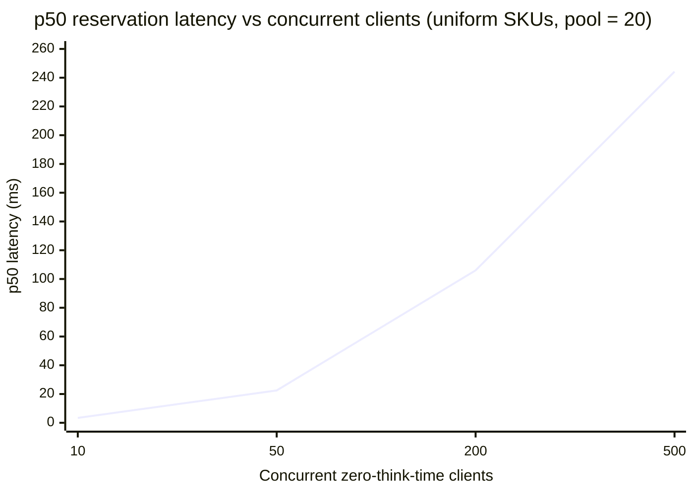
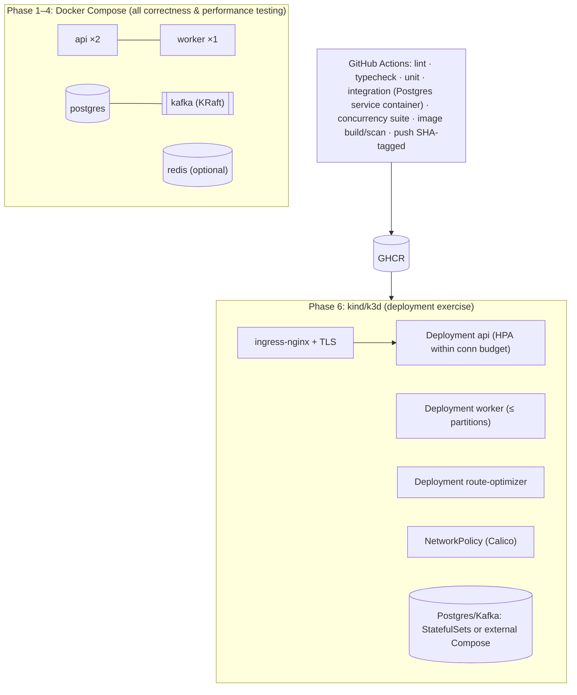

# RetailFlow — Independent Architecture Audit & Production-Readiness Assessment

**Date:** 2026-11-21 · **Subject:** proposed architecture (pre-implementation) · **Status:** audit only; no application code exists

---

## 0. Scope, method and evidence labels

**What was audited.** The workspace contained **no implementation**: no code, schema, Dockerfiles, manifests or tests.
So this audit covers the *proposed* architecture and stack. Nothing could be code-reviewed, unit-tested, or
end-to-end load-tested, and **no claim in this document describes RetailFlow's runtime behaviour.**

To avoid a purely theoretical review, I built two isolated prototypes (`audit/prototypes/`). They test the
assumptions the design depends on most:

1. **Inventory reservation concurrency on a real PostgreSQL 18.7**: 7 tests, ~6 min runtime.
2. **Picking-route optimization**: graph model + OR-Tools vs. baselines, 2 scripts.

Every finding carries one of these labels:

| Label | Meaning |
|---|---|
| **[MEASURED]** | Produced by a prototype in this repo. Raw output in `audit/prototypes/*/results/`. Reproducible. |
| **[DOCUMENTED]** | Known, documented behaviour of a library or tool (defaults, protocol semantics). Not executed here. **Verify against the version you adopt.** |
| **[ANALYSIS]** | Engineering reasoning about the proposed design. Not measured. |
| **[ASSUMPTION]** | An input I had to assume. It must be validated. |

**Test environment for [MEASURED] results:** Intel i5-1135G7 (4C/8T), 7.7 GB RAM, Windows 11. PostgreSQL 18.7
(embedded, `fsync` on) and Node v24.11.1 on the **same** machine, plus Python 3.12 with OR-Tools 9.15. Docker, Kafka,
Redis, kubectl and k6 are **not installed**. Absolute numbers are laptop-specific; **use them for
relative comparisons, not capacity planning.**

**What could not be executed (and why):** Kafka, Redis, outbox→Kafka→consumer flows, Kubernetes, k6 load tests,
failure injection, offline sync and security testing all need an application that doesn't exist yet. Instead:
- §8 includes a runnable k6 profile (`audit/load-tests/k6/retailflow-load.js`).
- A failure-injection runbook is in `audit/load-tests/FAILURE_INJECTION_RUNBOOK.md`.
- Both are labelled **not executed**.

---

## A. Executive verdict

**Short answer:** the project is feasible and worth building, but the plan as written is **over-engineered in
infrastructure and under-engineered in exactly the places the project claims as its depth.**

| Question | Verdict |
|---|---|
| Architecturally sound? | **Not yet.** The component list is reasonable. The *hard parts* (reservation semantics, lock ordering, outbox publication, consumer idempotency, offline sync protocol, authorization model) are named but not designed. Those are where systems like this fail, and the prototypes show each has a common implementation that is silently wrong. |
| Over-engineered? | **Yes, in infrastructure.** Kubernetes + Helm + Kafka + Redis + a separate Python service, run by one developer on a 7.7 GB laptop, is more moving parts than the problem needs. A single-node K8s cluster adds **zero** availability. |
| Under-engineered? | **Yes, in correctness.** No consistency model, idempotency scheme, conflict taxonomy, connection budget or authorization model is specified. |
| Technically feasible? | **Yes.** Nothing proposed is exotic. Measured on a laptop, PostgreSQL handled ~1,500–1,900 reservation transactions/s ([MEASURED] T3). The heaviest proposed scenario needs roughly 50–130 writes/s ([ANALYSIS] §8.1). |
| Maintainable? | **Only if scope is cut.** Five runtimes/stateful systems to operate, upgrade and debug is a large surface for one person. |
| Suitable for an advanced individual project? | **Yes, if it is reshaped** around demonstrable correctness under concurrency and failure, not around the length of the tech stack. |

**The single most important finding.** The *default* way most developers would write inventory reservation
(read stock, check in application code, write back) **oversold 10 units of stock as 465 reservations** under 500
concurrent requests ([MEASURED] T1). The *default* way to reserve a multi-line order (lock lines in request order)
**collapsed from 150 to 0.4 committed orders/s** with 172 deadlocks ([MEASURED] T4). Neither failure is caused by Kafka,
Redis or Kubernetes, and none of those technologies prevents it. The project's credibility depends on these
details, not on the stack.

---

## B. Architecture scorecard

These scores rate the **proposal as specified**. They do not rate code, because none exists. A low score means
"unspecified or wrongly specified", not "badly built".

| Area | Score | Reason |
|---|---|---|
| Architecture quality | **5/10** | The modular monolith + workers direction is right. Component boundaries are loosely justified. The Python service and K8s are not justified by requirements. |
| Distributed-systems correctness | **3/10** | Outbox and idempotency are named but not designed. No event envelope, versioning, ordering key, dedupe store or DLQ policy. The naive outbox poller loses events ([MEASURED] T6). |
| Database consistency | **4/10** | PostgreSQL is the right choice. No reservation model, constraints, lock order, isolation strategy or connection budget. |
| Offline reliability | **2/10** | IndexedDB + Service Worker are *storage technologies*, not a sync design. No operation identity, per-op results, conflict rules, lease semantics or shared-device handling. |
| Backend design | **5/10** | The stack is fine. Error handling, timeouts, transaction boundaries and the API contract are undefined. |
| Frontend design | **5/10** | The stack is fine. The offline UX for rejected operations (where most of the real complexity lives) is unaddressed. |
| Security | **2/10** | No authentication/authorization model, store-isolation strategy, device identity or internal-service trust model. |
| Scalability | **5/10** | Raw throughput needs are modest. The risks are contention shape and connection math, neither of which is addressed. |
| Route optimization | **4/10** | "Use OR-Tools" is a tool choice, not a problem definition. Measured: the baseline already gets within 1–3%, and naive OR-Tools modelling **fails** on constrained instances ([MEASURED] §7). |
| Cloud readiness | **3/10** | No probe semantics, graceful shutdown, resource sizing, backup/restore or secret handling. K8s on one node is not HA. |
| Testability | **4/10** | Stress testing is ambitious but lacks correctness invariants. "No errors under load" is not the same as "no oversell". |

---

## 1. Technology-by-technology evaluation (Part 2)

| Tech | Why needed / problem solved | Unnecessary complexity? | If it fails | Simpler alternative | Op. cost | **Verdict** |
|---|---|---|---|---|---|---|
| React + TS + Vite + Tailwind | Employee PWA + admin UI | No | UI only | — | Low | **Keep** |
| IndexedDB | Durable on-device op log + task cache | Necessary for offline | Ops lost if evicted / not persisted | `idb` wrapper library, not raw API | Low | **Keep**, with persistence request + quota handling (§6) |
| Service Worker / PWA | App-shell caching, installable | Moderate. SW caching bugs are notorious | Stale app version, cached authenticated data | Cache app shell only; **do not** cache API responses in the SW | Low | **Keep, narrowly** |
| Node + Express + TS | API | No | — | Use **Express 5** (async errors propagate) | Low | **Keep** |
| PostgreSQL | System of record, inventory truth, outbox, idempotency, sync-op log | No: it does more work than anything else here | Total write outage | — | Medium | **Keep, and use it more** |
| Redis | Cache, distributed rate limit | **Optional.** Nothing in the core needs it at this scale | Must degrade to Postgres reads + in-process limiter | Skip until a measured read hotspot exists | Low | **Postpone or keep minimal**, never authoritative (§5.4) |
| Kafka | Durable fan-out of domain events, replay, consumer groups | **Yes, for the load.** Postgres alone can carry these volumes | Async reactions pause; outbox absorbs the backlog | A Postgres job queue (`FOR UPDATE SKIP LOCKED`) | **High** (JVM, ~1 GB+ RAM, partitions, rebalances) | **Keep only as a deliberate learning objective**, off the synchronous write path, single KRaft broker locally |
| Transactional outbox | Atomic "state change + event" | No: it's essential if Kafka is used | Backlog grows; no loss if designed right | — | Low | **Keep; design it correctly** (§5.3) |
| Background workers | Outbox publish, consumers, expiry jobs | No | Async work pauses | — | Low | **Keep**, same codebase as the API (§3) |
| Python + FastAPI + OR-Tools | Constrained routing / batching | **Partly.** For single-picker TSP, a 100-line TS heuristic is within 1–3% ([MEASURED] §7) | Picks must still proceed. Needs a fallback | NN + 2-opt / S-shape in TS | Medium (2nd runtime, image, CI lane) | **Postpone to a later phase**; justify it with *batching/capacity* problems |
| Docker / Compose | Reproducible local stack | No | — | — | Low | **Keep; primary test environment** |
| Kubernetes + Helm | Orchestration, rollouts, probes | **Yes, for one developer.** No availability gain on one node | Cluster overhead competes with the system under test | Compose for all testing; K8s (kind/k3d) as a final deployment exercise | **High** (RAM, YAML, debugging) | **Postpone to final phase**; app tier only |
| GitHub Actions + registry | CI, image publishing | No | Deploys blocked, runtime unaffected | — | Low | **Keep** |

**Kafka client note [DOCUMENTED; verify current status]:** KafkaJS, historically the default Node client, has had
no release since early 2023, and its maintainers publicly sought new maintainers. Confluent ships
`@confluentinc/kafka-javascript` (librdkafka-based, with a KafkaJS-compatible API). Evaluate that before writing the
worker.

**RAM budget on your 7.7 GB laptop [ANALYSIS; estimates, measure with `docker stats`]:** a single Kafka broker
(default 1 GB heap, plus page cache) uses roughly 1–1.5 GB. Postgres takes 0.3–0.5 GB, two API replicas plus a worker
0.4–0.6 GB, and the optimizer 0.2–0.3 GB. A kind/k3d control plane adds roughly 1–1.5 GB and the Docker/WSL2 VM about
1 GB, with the IDE and browser on top. **Running the whole stack on Kubernetes on this machine is very likely to swap,
and a swapping machine produces worthless performance numbers.** That alone is reason to do performance work on
Compose.

---

## 2. Part 3 — Architecture audit

### 2.1 Modular monolith + async workers (A) vs. microservices (B)

| Criterion | A: Modular monolith + workers | B: Microservices |
|---|---|---|
| Inventory + order consistency | **Single DB transaction** (reserve + order + outbox) | Saga across services; compensation logic; harder to test |
| Failure points | API, worker, DB (+ Kafka, optimizer) | Every service × network hop |
| Latency | In-process calls | Network hops on the critical path |
| Independent deploy/scale | API and worker scale separately (same image, different entrypoint) | Per service |
| Debuggability without tracing infra | Good: one log stream, one DB | **Poor.** You excluded distributed tracing, and microservices without it are very hard to debug |
| One-person effort | Appropriate | ~2–3× the code for the same features |

**Recommendation: A.** One TypeScript codebase with strict module boundaries (`inventory`, `orders`, `picking`,
`sync`, `identity`). It is deployed as two **process roles** from one image:
- **`api`**: HTTP only, stateless.
- **`worker`**: outbox publisher, Kafka consumers, scheduled jobs (reservation expiry, cleanup).

Microservices would *add* the distributed transactions this project should avoid. Excluding tracing makes
microservices a particularly bad fit.

**Answers to the specific questions:**
1. *Modular monolith appropriate?* Yes.
2. *Independently deployable services necessary?* No. Two process roles are enough.
3. *Separate Kafka worker?* Yes, as a separate **process**: different scaling, different failure behaviour, and long-running
   consumers shouldn't share an event loop with request handling. Not as a separate **codebase**.
4. *Python as an independent service?* Only when OR-Tools is actually needed (§7). OR-Tools has no official Node
   binding, and CPU-bound solves must not block Node's event loop, so *if* it's used, a separate service is right.
   It must be stateless, time-bounded, called asynchronously, and **never on the order-placement path**.
5. *PostgreSQL used correctly?* Unknown: undefined. §5 and §13.3 define it.
6. *Redis appropriate?* Only as a non-authoritative cache/limiter.
7. *Kubernetes justified?* Not for reliability. Acceptable as a final-phase deployment-skills exercise.
8. *Too many failure points?* Yes, as proposed. The redesign removes Redis and Python from every critical path.
9. *Unnecessary service latency?* Only if the optimizer or Redis is put on the request path. Don't.
10. *SPOFs?* PostgreSQL is a SPOF in every variant. That's acceptable for this project if it's stated and backups are
    *restore-tested*. A single Kafka broker is a SPOF for async processing only, if Kafka is kept off the write path.

### 2.2 High-level architecture (recommended)



### 2.3 Component interaction: what is synchronous and what is not



**Rule:** if a step's failure must fail the user's request, it belongs in the Postgres transaction. Everything else
goes through the outbox. Kafka never sits between a user and a stock decision.

---

## 3. Part 4 — Failure Mode and Effects Analysis

Likelihood (L) and Impact (I) are on a 1–5 scale and are **[ANALYSIS]** estimates for this project's realistic usage,
not measured probabilities. Risk = L×I.

| # | Component | Failure scenario → root cause | L | I | Risk | Detection | Recovery | Data-integrity implication | Prevention |
|---|---|---|---|---|---|---|---|---|---|
| F1 | Core backend: reservation | Read-then-write reservation → lost update / oversell | 4 | 5 | **20** | Invariant query I2 (§8.5). Not visible in error rates | Manual reconciliation | **Oversell; reserved counter ≠ reservations** ([MEASURED] T1: 455 oversold) | Guarded conditional `UPDATE` + CHECK constraint |
| F2 | PostgreSQL locks | Multi-line orders lock SKUs in arbitrary order → deadlocks → lock convoy | 4 | 5 | **20** | `40P01` in logs; `pg_stat_database.deadlocks` | Retry storm worsens it | Orders rejected; none corrupted | Sort lines by (store, sku); short tx; `lock_timeout`; bounded retry ([MEASURED] T4) |
| F3 | Offline sync | Ops replayed/lost, conflicting picks, shared-device identity mix-up | 4 | 4 | **16** | Requires per-op result table; otherwise invisible | Supervisor review queue | Double-applied scans; ops applied as wrong employee | Op identity + per-op results + leases (§6) |
| F4 | Outbox publisher | Watermark polling skips late commits; multi-instance publishers reorder events | 3 | 5 | **15** | Invariant I5; consumer gap detection by aggregate version | Republish from outbox | **Silent event loss** ([MEASURED] T6) | Poll `published_at IS NULL`; single leader via advisory lock |
| F5 | DB connections | Replicas × pool > `max_connections`; pool wait unbounded | 3 | 5 | **15** | `53300` errors; pool wait time | Scale down / restart | None (requests fail) | Connection budget; pool `connectionTimeoutMillis`; load shedding ([MEASURED] T5) |
| F6 | Kafka consumer | Non-idempotent handler + redelivery after crash/rebalance → double effects | 4 | 4 | **16** | Duplicate rows / counters | Manual | **Double pick tasks, double notifications** | `processed_events` PK in same tx as effect |
| F7 | Kafka consumer | Poison message blocks partition (retry forever) | 3 | 4 | 12 | Lag grows on one partition only | Skip/DLT | Downstream stalls for that key range | Bounded retry → DLT with error metadata |
| F8 | Authentication / authz | Store isolation enforced by request param → BOLA | 3 | 5 | **15** | Only through tests | — | Cross-store data exposure/modification | Scope from token claims in repository layer; tests |
| F9 | Redis | Outage + client defaults (offline queue, many retries) → every request waits | 3 | 3 | 9 | p95 jump correlated with Redis | Auto when Redis returns | None if Redis non-authoritative | `enableOfflineQueue:false`, 1 retry, 50–100 ms command timeout, fail-open |
| F10 | Kafka broker | Broker down (single broker) | 3 | 2 | 6 | Publisher errors; outbox backlog | Auto drain after restart | None, *if* outbox rows remain until published | Keep Kafka off write path; outbox retention |
| F11 | Kafka producer | Ack lost after broker wrote → publisher retries → duplicate event | 4 | 2 | 8 | Duplicate `event_id` at consumer | n/a | None if consumers dedupe | Idempotent producer + consumer dedupe by `event_id` |
| F12 | Python optimizer | Unbounded solve time / oversized input → CPU saturation, timeouts | 3 | 2 | 6 | Latency/timeouts in worker log | Fallback route | None | Server-enforced time limits and item caps; fallback heuristic ([MEASURED] up to 7 s unbounded) |
| F13 | Reservation expiry job | Release races pick-confirm → double decrement | 3 | 4 | 12 | CHECK violations (if constraint exists) | — | **Corrupted `reserved`** without constraint ([MEASURED] T7: 497/500 races) | Compare-and-set state transitions |
| F14 | Frontend / SW | Service worker serves stale bundle with an old sync protocol | 3 | 3 | 9 | Server sees old `client_version` | Force update | Ops in old format rejected | Versioned sync API; SW update flow; server accepts N-1 |
| F15 | K8s probes | Liveness checks DB → DB blip → all pods restarted together | 3 | 4 | 12 | Restart counts | Self-inflicted | In-flight requests lost | Liveness = process health only; readiness = dependencies |
| F16 | K8s nodes | Single-node cluster node/VM dies | 2 | 5 | 10 | Everything down | Manual | Depends on PV durability | State it; backups; don't claim HA |
| F17 | Container registry | Registry unavailable / image tag mutable | 2 | 2 | 4 | ImagePullBackOff | Cached images keep running | Inconsistent versions across pods if `latest` used | Immutable tags (git SHA) |
| F18 | Cloud networking | NetworkPolicy not enforced (kind default CNI), DNS issues | 3 | 3 | 9 | Policy tests | — | Internal services reachable by anything | Calico on kind if policies matter; test them |
| F19 | External deps | npm/PyPI outage or compromised package at build | 2 | 4 | 8 | CI failure / audit | Pin + cache | Supply-chain compromise | Lockfiles, `npm ci`, dependency scanning |
| F20 | PostgreSQL | Disk full / WAL growth from outbox churn; no restore ever tested | 2 | 5 | 10 | Disk alerts (manual) | Restore | **Unrecoverable loss if backups untested** | Outbox cleanup job; scheduled `pg_dump` + restore test in CI |

### 3.1 Most dangerous failure modes (ranked)

1. **F1 Oversell via read-then-write.** Silent and data-corrupting. Error dashboards stay green.
2. **F2 Deadlock collapse on multi-line orders.** Sudden, and it worsens under the retries meant to fix it.
3. **F4 Outbox event loss.** Silent. Downstream (pick tasks) never happens for some orders.
4. **F3 Offline sync double-apply / mis-attribution.** Silent, and only discovered during physical stock counts.
5. **F8 Cross-store authorization gaps.** A security incident rather than a reliability one.

All five are **silent**: they corrupt data or authorization without raising error rates. That's why the testing
strategy (§8.5) is built on **invariants**, not error rates.

### 3.2 Five most serious architectural weaknesses

1. The **reservation model is undefined** (no conditional updates, constraints, lock order or state machine).
2. **Offline sync has no protocol.** The PWA stack is named, but there's no design for operation identity, per-op results, conflicts or leases.
3. **Event pipeline semantics are undefined** (outbox claiming, ordering key, event versioning, consumer dedupe, DLT).
4. **No authorization or trust model** (store scope, roles, device identity, internal services).
5. **Infrastructure is disproportionate** (K8s/Helm/Kafka/Redis/Python) relative to one developer and a 7.7 GB laptop. It diverts effort from items 1–4.

### 3.3 Cascade sequences

**Cascade 1: DB slowdown → pool exhaustion → full API outage [ANALYSIS, supported by T3/T5].**
1. A long-running query, or vacuum/IO pressure, raises transaction latency from ~4 ms to ~40 ms.
2. Each pool connection's throughput drops 10×. Requests queue in the Node pool. `pg`'s default
   `connectionTimeoutMillis` is 0, i.e. **wait forever** [DOCUMENTED].
3. The queue grows without bound. Memory rises, and all endpoints slow down, including ones that don't touch the slow table.
4. Clients and k6 time out and **retry**, which raises the load.
5. With a K8s HPA on CPU, new replicas each bring a full pool. Total connections exceed `max_connections`, and new pods fail
   with `53300` ([MEASURED] T5: 15 of 120 connections refused). A liveness probe that checks the DB then restarts
   pods, dropping all in-flight requests.
   - **Business impact:** order placement and picking stop entirely, not just slow down.
   - **Break the chain:** pool acquire timeout (e.g. 2 s) → fast 503 + `Retry-After`; `statement_timeout`;
     `idle_in_transaction_session_timeout`; connection budget; liveness ≠ DB health; client retry with jitter and caps.

**Cascade 2: Reconnect storm [ANALYSIS].**
1. Store Wi-Fi drops for 30 minutes.
2. 200 devices queue ~100 ops each.
3. Wi-Fi returns, and every device syncs within the same few seconds: 20,000 ops.
4. If `/sync` applies a batch in one transaction, it holds locks on hot SKUs for a long time. That triggers Cascade 1 plus lock
   convoys, and order placement for *online* customers stalls too.
   - **Break the chain:** per-op (or small-chunk) transactions; per-device concurrency of 1; server-side 429 with jittered
     `Retry-After`; batch-size cap; optionally a separate pool for sync so that it can't starve order placement.

**Cascade 3: Kafka down → nothing visible at first → pick tasks never created [ANALYSIS].**
1. Orders keep succeeding (correctly), and outbox rows accumulate.
2. Without a backlog check in the health/status endpoint, nobody notices until stores report "no pick tasks".
   - **Break the chain:** worker `/internal/status` exposes outbox backlog age; readiness of the *worker* reflects publisher
     health; the order timeline (§12) shows "event not yet published".

---

## 4. Part 5 — Distributed systems & data consistency

### 5.1 Inventory consistency: measured

**Model tested:** `inventory(store_id, sku, on_hand, reserved)` with
`CHECK (reserved >= 0 AND reserved <= on_hand)`, plus a reservations table and an outbox table. Each reservation is one
transaction. The pool has 50 connections; requests fire concurrently.

**T1: Last-unit race [MEASURED]** (`results/run2-T1-warm-T5.json`)

| Strategy | Stock | Attempts | Reservations created | Oversold | Notes |
|---|---|---|---|---|---|
| Read → check in app → `UPDATE SET reserved = <computed>` (READ COMMITTED) | 1 | 200 | **50** | **49** | Lost updates: counter says 1, 50 rows exist |
| same | 10 | 200 | **195** | **185** | |
| same | 10 | 500 | **465** | **455** | |
| Same logic at SERIALIZABLE, **no retry** | 10 | 200 | 7 | 0 | **193 failed with 40001.** Correct, but **under-sells**: 3 units falsely "out of stock" |
| SERIALIZABLE **with retry** (≤20, jittered) | 10 | 500 | 10 | 0 | Correct; 490 retries |
| **Guarded conditional UPDATE** `... SET reserved = reserved + $q WHERE ... AND on_hand - reserved >= $q` | 1 / 10 / 10 | 200 / 200 / 500 | **1 / 10 / 10** | **0** | Correct, no retries, fastest |

Why the guarded update is correct at READ COMMITTED: a blocked `UPDATE` re-evaluates its `WHERE` clause against
the *newly committed* row version (PostgreSQL's EvalPlanQual re-check). The availability check and the
decrement are a single atomic step on the row.

A methodology note matters here: the first T1 run showed **no** oversell for the naive strategy. The cause was a cold
connection pool. Slow Windows backend startup staggered the 200 requests so the race never occurred. A test that
"passes" because it accidentally serializes is the most dangerous kind. Concurrency tests must warm pools and
assert that the race window was actually exercised.

**T2: Idempotency [MEASURED].** 100 concurrent submissions with the same idempotency key → **1 reservation, 99
`duplicate`, 1 outbox row, correct counter.** The mechanism: a `UNIQUE` index on the key plus
`INSERT ... ON CONFLICT DO NOTHING`, *inside the same transaction* as the decrement. Concurrent duplicates block on the
unique index until the first transaction commits.

**T7: Incorrect release [MEASURED].** An expiry job releasing a reservation raced a picker confirming it, 500
trials per variant:
- **Read status, then update:** both transactions applied their decrement in **497/500** trials. Corruption was only
  prevented because the CHECK constraint rejected the second decrement (the operation errored instead).
  **Without the CHECK constraint, `reserved` would have gone negative 497 times.**
- **Compare-and-set** `UPDATE reservations SET status='released' WHERE id=$1 AND status='active'` (proceed only if
  `rowCount = 1`): **0 corruptions, 0 constraint errors.**

**T4: Deadlocks [MEASURED].** 100 concurrent orders, 5 lines each, drawn from 20 hot SKUs, all lines in one transaction:

| Lock order | Orders attempted | Committed | Deadlocks | Committed orders/s | p50 | p99 |
|---|---|---|---|---|---|---|
| As listed in request | 227 (stopped after 60 s + drain) | 55 | **172** | **0.4** | **42.7 s** | 136.7 s |
| Sorted by SKU | 1,000 | 1,000 | **0** | **150** | 46 ms | 6.0 s |



Each deadlock costs `deadlock_timeout` (1 s default) before detection, and the victim retries into the same
contention. The 6 s p99 even with sorted locks is a **lock convoy**: 100 transactions queue on the same 20 rows. Two
defences address it: shorter transactions, and admission control (fewer concurrent writers per hot SKU than pool slots).

**Recommended reservation design**
1. `inventory_balances(store_id, sku, on_hand, reserved, version)` with `CHECK (0 <= reserved AND reserved <= on_hand)`
   and `CHECK (on_hand >= 0)`.
2. All reservation writes are guarded conditional `UPDATE`s at READ COMMITTED. Don't use SERIALIZABLE for this path: it
   is correct but needs retries, and without them it rejects valid orders.
3. Multi-line orders: lock in deterministic order (`ORDER BY store_id, sku`). Choose the policy explicitly: **all-or-nothing**
   (simplest, recommended) or partial allocation.
4. Reservation state machine, `active → picked | released | expired`, every transition compare-and-set.
5. Every stock change writes an **append-only `inventory_ledger`** row with `source_type` and `source_id`, and
   `UNIQUE(source_type, source_id, sku)`. That gives idempotency for stock movements, auditability, and a way to
   reconcile `on_hand` (invariant I3).
6. Idempotency: **prefer natural keys** (`UNIQUE(order_line_id)` on reservations) over client keys. Use client keys
   (`Idempotency-Key`) for API retries, **scoped to the authenticated principal** (see S-09).
7. Transaction hygiene: no network calls (Kafka, Redis, optimizer) inside a transaction. Set `lock_timeout` ≈ 2 s,
   `statement_timeout` ≈ 5 s, `idle_in_transaction_session_timeout` ≈ 10 s. Retry `40P01`/`55P03` at most 3× with jitter.

**Behaviour under hundreds or thousands of concurrent attempts [MEASURED T3 + ANALYSIS]:** correctness holds (the
invariant held in every T3 run, 0 errors). Throughput is bounded by **pool size × 1/transaction-time**. A single SKU
is bounded by **1/row-lock-hold-time**, about 1,000 tx/s on this laptop. Beyond the pool size, extra concurrency adds only
queueing delay (next section).

### 5.2 Kafka reliability [ANALYSIS / DOCUMENTED; not executed]

| Concern | Design decision |
|---|---|
| Delivery | At-least-once end to end. **Kafka "exactly-once" (transactions) only covers Kafka-to-Kafka. It does not cover your Postgres side effects**, so dedupe in the consumer DB transaction. |
| Duplicates | Event envelope `{event_id (UUIDv7), type, schema_version, aggregate_type, aggregate_id, aggregate_version, occurred_at, correlation_id, payload}`. Consumer inserts `(consumer_name, event_id)` into `processed_events` **in the same transaction** as its effects; on conflict → skip. |
| Ordering | Only per partition. Key = `aggregate_id` (order id for order events; `store:sku` for inventory). Consumers also compare `aggregate_version` and ignore stale versions, so ordering survives republishing. |
| Partitions | 6 per topic locally (≥ max consumer instances). More partitions don't help at this volume. |
| Consumer groups / rebalancing | One group per concern (`pick-task-builder`, `route-planner`, `cache-invalidator`). Cooperative-sticky assignment. Keep per-message processing short: **never** call the optimizer synchronously inside a consumer with a tight poll interval. |
| Offsets | Commit **after** the DB transaction commits. A crash in between means redelivery, which dedupe handles. |
| Poison messages | Up to 3–5 in-process retries with backoff → produce to `<topic>.dlt` with original headers + error, then commit. Never block a partition indefinitely. |
| Replay | Retain topics ≥ 7 days locally, plus outbox rows retained N days; a rebuild consumer can reset offsets. |
| Schema evolution | JSON + Zod schema per `type@schema_version`; additive changes only; consumers ignore unknown fields. Schema Registry is postponable. |
| Backpressure | The consumer pauses its partition when the downstream (optimizer) is saturated. Lag is visible via admin offsets in `/internal/status`. |

**Are consumers genuinely idempotent?** They are not as specified: nothing is specified. Only the
`processed_events`-in-same-transaction pattern makes them idempotent. Kafka settings alone do not.

### 5.3 Transactional outbox: every boundary

```mermaid
sequenceDiagram
  autonumber
  participant API
  participant PG as PostgreSQL
  participant PUB as Outbox publisher (single leader)
  participant K as Kafka
  participant C as Consumer
  participant CDB as Consumer tables (same PG)
  API->>PG: BEGIN; business writes; INSERT outbox; COMMIT
  Note over API,PG: Crash before COMMIT → nothing happened (atomic)
  PUB->>PG: pg_try_advisory_lock(leader); SELECT … WHERE published_at IS NULL ORDER BY id LIMIT 500
  PUB->>K: produce batch (acks=all, idempotent producer, key=aggregate_id)
  Note over PUB,K: Crash after Kafka ack, before UPDATE → republished → duplicate (expected)
  K-->>PUB: ack
  PUB->>PG: UPDATE outbox SET published_at = now() WHERE id = ANY($ids)
  K->>C: deliver
  C->>CDB: BEGIN; INSERT processed_events(consumer, event_id) ON CONFLICT DO NOTHING; effects; COMMIT
  Note over C,CDB: Crash before offset commit → redelivery → dedupe skips
  C->>K: commit offset
```

| Boundary failure | Handling |
|---|---|
| DB commits, publisher crashes | Row stays `published_at IS NULL` → picked up after restart. **No loss.** |
| Kafka stored the event, ack lost | Publisher retries → duplicate in Kafka → consumer dedupes by `event_id`. |
| Publisher restart / two publishers | **Single leader** via `pg_try_advisory_lock`. Two publishers using `SKIP LOCKED` can publish two events for the same aggregate in different batches, out of order. |
| Consumer crash before offset commit | Redelivery → `processed_events` conflict → skip. |
| Consumer DB tx fails | Don't commit the offset. Retry, then DLT. |
| Out-of-order events | Per-key partitioning + `aggregate_version` check. |

**T6: High-watermark polling loses events [MEASURED].** A publisher that polls `WHERE id > last_published_id`
lost an event deterministically:
1. Transaction A took outbox id 1 but committed late.
2. Transaction B took id 2 and committed immediately.
3. The publisher saw only id 2 and advanced its watermark to 2.
4. A committed, and id 1 became visible *below* the watermark.

Result: **`lostEvents: ["A_slow_tx"]`.** Sequence values are allocated at insert time, not at commit time, so ids don't reflect commit order.
**Fix:** claim by `published_at IS NULL`, with a partial index
`CREATE INDEX ON outbox (id) WHERE published_at IS NULL`. Delete or archive published rows on a schedule, or the
table and index bloat.

### 5.4 Redis [ANALYSIS / DOCUMENTED]

- **Never authoritative for inventory. No Redis locks (Redlock) for reservations.** Postgres row locks already
  provide correct mutual exclusion inside the transaction that matters. A Redis lock adds a second, weaker
  consistency domain with expiry-based safety.
- Cache-aside for catalog and *display* availability, TTL 10–30 s with ±20% jitter, plus event-driven invalidation from the
  worker. The displayed availability is allowed to be stale; **the reservation always re-checks Postgres.**
- Stampede: single-flight per key within each process, plus TTL jitter.
- **Outage behaviour:** ioredis defaults (`enableOfflineQueue: true`, `maxRetriesPerRequest: 20`) [DOCUMENTED; verify]
  queue commands during reconnects. A Redis outage then becomes a multi-second stall on every request that touches the
  cache. Set `enableOfflineQueue: false`, `maxRetriesPerRequest: 1`, `commandTimeout` 50–100 ms, plus a circuit breaker.
  Cache → bypass; rate limiter → in-process fallback (stricter limits on `/auth/*`).
- Memory: `maxmemory` set, `allkeys-lru`, every key with a TTL, persistence off (it's a cache).
- Failover: not needed. A single instance is fine because nothing depends on it for correctness.

---

## 6. Part 6 — Offline-first audit and sync design

### 6.1 The core problem

Offline correctness in this domain is mostly *not* about the network. A reservation is a **quantity**, not a
specific physical unit. Two pickers can each hold a valid reservation while the shelf holds one unit, because the
inventory record was already wrong (damage, theft, misplacement). So the system must treat **"short pick" (item not
found) as a first-class, expected flow**. Offline delay only widens the window in which the record and reality disagree.

### 6.2 Operation model

Each device keeps an **append-only op log** in IndexedDB:
`{op_id: UUIDv7, device_id, employee_id, seq (per device, monotonic), type, task_id, payload, base_version, client_time, status}`.
The local UI state change and the op-log append happen **in the same IndexedDB transaction**.

```mermaid
sequenceDiagram
  autonumber
  participant UI as PWA UI
  participant IDB as IndexedDB (op log + task cache)
  participant API as /api/v1/sync
  participant PG as PostgreSQL
  UI->>IDB: tx{ append op(seq=n), update local task view }
  Note over UI,IDB: Offline: ops accumulate; UI shows "pending (n)"
  UI->>API: POST {device_id, ops[seq a..b]} (≤100 ops, one in-flight batch per device — Web Locks API across tabs)
  loop each op in seq order
    API->>PG: BEGIN; INSERT sync_ops(device_id, op_id) ON CONFLICT → return stored result
    API->>PG: validate (lease held? reservation active? task state?) ; apply ; ledger ; outbox ; store result ; COMMIT
  end
  API-->>UI: results[{op_id, status: applied|duplicate|rejected|retry, reason, server_state}]
  UI->>IDB: tx{ remove applied/duplicate; mark rejected → needs attention; keep retry }
  Note over UI,API: App killed mid-sync → ops still in IDB → resent → server returns stored results (idempotent)
```

### 6.3 Answers to the ten questions

1. **Offline for several hours?** Their assigned tasks are protected by a **task lease** (e.g. 4 h, shown on device).
   Within the lease, pick scans apply normally. After it expires, the server may have reassigned the task or released
   the reservations; those ops come back `rejected: LEASE_EXPIRED` and go to a supervisor review queue. **Not all
   offline ops can be guaranteed to succeed.** The UI must show the lease countdown and pending-op count.
   Separately, an expired access token must not lose ops: the device refresh credential needs to outlive a shift, or the
   employee must re-authenticate *without* clearing the queue.
2. **IndexedDB quota reached?** Quota and eviction are browser-specific [DOCUMENTED; verify per target browser]:
   best-effort storage can be evicted under storage pressure, and Safari has evicted script-writable storage for sites
   unused for 7 days. Mitigations:
   - Call `navigator.storage.persist()`.
   - Monitor with `navigator.storage.estimate()`.
   - Cache only *assigned* task data, not the 50k-product catalog.
   - On `QuotaExceededError`, evict caches first; **never** evict unsynced ops.
   - If an op can't be written, **block the scan with a visible error** rather than pretend it was recorded.
3. **App closes during sync?** IndexedDB transactions are atomic. Ops leave the log only after an acknowledged response.
   A resend returns stored results via `(device_id, op_id)`.
4. **Partial batch acceptance?** This is the normal case. Results are per op. A rejected op doesn't block unrelated later ops,
   but later ops on the **same task** after a rejection are returned `rejected: DEPENDENCY_REJECTED`.
5. **Ordering?** Per-device `seq`, applied in order. **No global order across devices, and device clocks are never used
   to resolve conflicts.** Server arrival plus domain rules decide.
6. **Duplicate prevention?** `UNIQUE(device_id, op_id)` with the stored result. Duplicate *physical* scans
   (the same barcode scanned twice) are a domain rule: the scan quantity can't exceed the task line's remaining quantity.
7. **Conflict detection?** Each op carries `base_version` of the task or line. The server compares it with current state
   and applies **typed rules**, not last-writer-wins:

| Op | Offline-safe? | Server rule |
|---|---|---|
| Pick scan on own leased task | **Yes** | Apply if lease valid and reservation active; else reject → review |
| Short pick / item not found | **Yes** | Always accept as an *observation*; triggers stock adjustment + reallocation |
| Cycle-count observation | **Yes, as observation** | Store `observed_qty` + `base_version`. If stock moved since, flag for recount rather than overwrite |
| Stage / complete task | Yes | Valid only if every line is resolved |
| Claim a new task | **No: needs server** | Assignment is a server-side compare-and-set |
| Reserve stock / cancel order / substitution | **No** | Server-confirmed only |
| Price or catalog edits | **No** | |

8. **Which ops are safe offline?** See the table above. **Which need confirmation?** Anything that allocates a shared resource.
9. **Pick inventory reserved by someone else?** Physically, yes: reservations are quantities, not units. The system
   prevents *logical* double allocation (leases + reservations), and short-pick handles the physical mismatch.
10. **Shared devices** (a gap in the brief): ops are bound to `employee_id`. On logout, unsynced ops must either sync
    first or stay attributed to the original employee, and must be uploadable only with that employee's credential or a
    device credential that signs the employee binding. Cached task data is cleared per user on logout.

**Where stale data causes operational errors:** displayed availability (harmless, because reservation re-checks), task
assignment (prevented by leases), and bin locations (stale → walks to the wrong bin → short pick). Show the
`last synced` time prominently.

**Service Worker caveats [DOCUMENTED; verify]:** the Background Sync API is not available in Safari or Firefox. Don't
depend on it; sync on `online`, on app foreground and on a timer. Don't cache authenticated API responses in the SW
Cache API, because they survive logout on shared devices.

---

## 7. Part 7 — Route optimization audit [MEASURED unless noted]

**Model:** graph with 20 aisles × 50 m, 3 m spacing, cross-aisles at the front, middle and back (a 2-block layout).
1,020 nodes. Dijkstra builds the pick-to-pick distance matrix. Depot (entry/exit) is at the front of aisle 0. Time
estimate: 1.2 m/s walking + 10 s per pick. 5 random orders per size. The gap is measured against exact Held-Karp
(≤12 items) or against the best solution found (OR-Tools GLS, 3 s).

| Items | Nearest-neighbour | S-shape | NN + 2-opt | OR-Tools default¹ | OR-Tools GLS 1 s | Matrix build |
|---|---|---|---|---|---|---|
| 8 | +9.3% | +14.4% | +1.8% | +0.4% (15 ms) | **optimal** | 7 ms |
| 12 | +7.0% | +13.3% | +0.3% | +0.3% (5 ms) | **optimal** (Held-Karp confirms) | 11 ms |
| 25 | +13.0% | +22.7% | +2.3% | +0.5% (13 ms) | 0.0% | 26 ms |
| 50 | +11.1% | +26.8% | +2.9% | +1.6% (78 ms) | +0.3% | 76 ms |
| 100 | +13.7% | +14.4% | +1.3% | +1.5% (239 ms) | +1.2% | 92 ms |
| 200 | +9.7% | **−0.5%** | +2.1% | +0.8% (1.1 s, max 1.9 s) | +0.7% | 212 ms |
| 400 | +5.7% | **−2.5%** | n/a | −0.2% (**5.3 s, max 7.1 s**) | +0.7% | 434 ms |

¹ PATH_CHEAPEST_ARC + greedy local search with **no time limit**. Runtime grows super-linearly.



**What the measurements say, candidly:**
1. **NN + 2-opt (≈100 lines of TypeScript, <20 ms) gets within 1–3% of the best route** up to 200 items.
   OR-Tools' marginal gain over it is 1–3% of *walking distance*.
2. **Walking is a minority of pick time** under these assumptions. For a 50-item pick: ~9 min walking vs. 8.3 min of picking
   (17.1 min total). The 2.9% distance gap is about **15 s on a 17 min pick (~1.5%)**. The NN→optimal gap (~11%, ~1 min) is
   worth closing, and 2-opt closes most of it.
3. **For dense picks (200–400 items), S-shape beats OR-Tools at 3 s.** When nearly every aisle has a pick, traversing
   every aisle is near-optimal. Use the classical warehouse result, not a general solver.
4. **Unbounded OR-Tools runtime is a production hazard:** up to 7.1 s at 400 items. Always set a time limit, and derive it from item count.
5. **Using a Python callback for distances is slow:** `RegisterTransitMatrix` was **1.8–2.8× faster** than a Python
   lambda transit callback (100 items: 93 vs 263 ms; 400: 1.9 s vs 3.6 s).
6. **Constraint modelling pitfall: temperature-sensitive items.** Constraint: each frozen item at most 40 m of walking before the exit.

| Items | Instances | Zone-sequenced heuristic (ambient → frozen → exit) | OR-Tools + constraint, unseeded | OR-Tools + constraint, **seeded** with heuristic |
|---|---|---|---|---|
| 25 | 5 | 5/5 feasible, 442 m | **1/5 solved** | 5/5 feasible, 430 m |
| 50 | 5 | 5/5 feasible, 601 m | **0/5 solved** | 5/5 feasible, 587 m |
| 100 | 5 | 5/5 feasible, 897 m | **0/5 solved** | 5/5 feasible, 882 m |

Unconstrained routes violated the frozen rule in 13–14 of 15 instances (NN 14, S-shape 14, unconstrained OR-Tools 13).
**Every instance was feasible.** OR-Tools' first-solution heuristics couldn't *find* a feasible start, so
the naive integration returns "no route". Seeding with a feasible heuristic fixes it and improves the route by a further 1.7–2.7%.

**Scaling and bottlenecks:**
- The distance matrix costs O(n · E log V). At 400 items that's 434 ms of Python Dijkstra. Store layouts are static, so
  **precompute all slot-to-slot distances once per layout version.** A 2,000-slot layout is a 4M-entry matrix, or use a
  closed form for rectilinear blocks.
- OR-Tools GLS capacity is roughly CPU cores ÷ time limit. Realistic demand is low: 200 pickers each requesting a route
  every ~10 min is about 0.33 requests/s [ANALYSIS].

**Recommended design:**
- **Phase 1:** a TypeScript `RoutePlanner` with S-shape and NN+2-opt (return the shorter) plus the zone-sequencing rule. This is
  also the permanent fallback.
- **Phase 2 (optional):** the Python OR-Tools service, justified by problems the heuristic *can't* handle well:
  - **order batching** (several orders per cart, with tote capacity)
  - **multi-picker assignment** (CVRP)
  - **pick time windows / cut-offs**

  Seed it with the heuristic, set `RegisterTransitMatrix` and a server-side time cap, and cap the input size.
- Every route records `algorithm`, `distance_m`, `est_seconds` and `solve_ms`. That gives you production comparison data for free.

---

## 8. Part 8 — Performance & stress testing

### 8.1 Workload model: employees ≠ VUs ≠ requests/s

[ANALYSIS; ASSUMPTION about behaviour] A picker produces about one scan every 15–30 s, so **500 employees ≈ 17–33
scans/s**. Scenario D's 10,000 orders over a 20-minute window is **8.3 orders/s ≈ 30 order-line reservations/s**
(at ~3.5 lines per order). That is about 50–65 writes/s, or **~100–130 writes/s with traffic doubled**. The prototype sustained ~1,500–1,900 reservation transactions/s on
a laptop (T3). The proposed scenarios therefore **do not stress raw throughput**. They stress *shape*:
- hot SKUs
- bursts (flash sale: the same 10,000 orders in 2 min = 83/s)
- reconnect storms
- connection math under scaling
- failure during load

The k6 profile (`audit/load-tests/k6/retailflow-load.js`) models this explicitly: open-model order arrivals, closed-model
pickers with think time, a reconnect-storm scenario, a traffic-doubling stage and a recovery stage.

### 8.2 Measured: reservation throughput vs. concurrency (T3) [MEASURED]

Concurrent clients here are **zero-think-time transaction loops**, far heavier than the same number of employees.
Pool = 20 (one process). Each operation is a full reservation transaction (idempotency insert + guarded update + outbox
insert + commit).

| Scenario | Clients | Products | Key distribution | Tx/s | p50 ms | p95 ms | p99 ms | Pool-wait p95 ms | Errors | Invariant |
|---|---|---|---|---|---|---|---|---|---|---|
| A | 10 | 500 | uniform | 1,701 | 3.4 | 5.5 | 8.0 | 0.03 | 0 | ✔ |
| A | 10 | 500 | 80% → hottest 1% | 1,620 | 3.3 | 7.5 | 18.5 | 0.03 | 0 | ✔ |
| A | 10 | 500 | single SKU | 957 | 5.9 | 19.3 | 53.1 | 0.03 | 0 | ✔ |
| B | 50 | 5,000 | uniform | 1,565 | 22.5 | 50.8 | 188.4 | 34.7 | 0 | ✔ |
| B | 50 | 5,000 | single SKU | 965 | 38.9 | 77.2 | 217.4 | 36.8 | 0 | ✔ |
| C | 200 | 20,000 | uniform | 1,704 | 106.0 | 158.2 | 292.4 | 148.4 | 0 | ✔ |
| C | 200 | 20,000 | single SKU | 967 | 185.9 | 349.7 | 404.0 | 307.6 | 0 | ✔ |
| D | 500 | 50,000 | uniform | 1,922 | 244.2 | 347.8 | 472.0 | 337.5 | 0 | ✔ |
| D | 500 | 50,000 | 80% → hottest 1% | 1,876 | 247.6 | 322.7 | 505.9 | 318.3 | 0 | ✔ |
| D | 500 | 50,000 | single SKU | 1,187 | 406.3 | 513.7 | 551.8 | 496.4 | 0 | ✔ |



**Interpretation:**
1. **Latency starts rising as soon as concurrency exceeds the pool size (20).** Throughput is flat from 10 to 500
   clients; the extra latency is almost all pool queueing. It follows Little's law: 500 / 1,922 ≈ 260 ms against a
   measured p50 of 244 ms.
2. **No errors appeared at any level, because pool waits are unbounded by default.** In production, unbounded waiting
   turns into client timeouts and retries (Cascade 1). Set an acquire timeout and shed load.
3. **A single hot row caps throughput at ~960–1,190 tx/s** here (the row lock is held for about 1 ms per transaction).
   That is about 10× above the flash-sale shape. Hot-row throughput becomes a problem only if transactions get longer, for
   example a network call inside the transaction or a slow commit.
4. The 1%-hot distribution behaved almost like uniform at these sizes. Contention bites with **multi-row transactions**
   (T4), not single-row ones.

**Connection exhaustion (T5) [MEASURED]:** 6 simulated replicas × pool 20 = 120 connections against
`max_connections = 100` → **15 connections refused with `53300 too many clients`**, 105 succeeded. With a 3 s
connect timeout (run 1), 87 of 120 failed instead. That shows a cold-start *connection storm* (many
backends forking at once) is its own failure mode, separate from the limit.

### 8.3 Progressive stress questions: measured where possible

| Question | Answer | Basis |
|---|---|---|
| When does latency rise? | As soon as in-flight transactions exceed the pool size | [MEASURED] T3 |
| When do errors appear? | Not from load alone, with unbounded pool waits. Errors appear with deadlock-prone lock order, connection limits or timeouts | [MEASURED] T3/T4/T5 |
| What saturates first? | DB pool / transaction throughput, then hot-row locks; **deadlocks first** if lock order is wrong | [MEASURED] |
| Traffic doubles? | With uniform keys, latency doubles (pure queueing) | [MEASURED] T3 trend; [ANALYSIS] |
| Traffic returns to normal? / Recovery? / Backlog growth? / Ops lost or duplicated? | Need the real app + Kafka; covered by runbook E1–E11 and k6 stages | **Not executed** |

### 8.4 Database stress: likely bottleneck queries as data grows [ANALYSIS]

1. **Outbox claim query.** Without a partial index on unpublished rows, and with no cleanup, it degrades into scanning millions of published rows.
2. **"Next pick task" claim.** Use `FOR UPDATE SKIP LOCKED` with an index on `(store_id, status, priority, created_at)`; otherwise many pickers contend on the same row.
3. **Reservation expiry sweep.** Needs a partial index on `(expires_at) WHERE status='active'`, and must work in batches (a full-table `UPDATE` would hold locks).
4. **Order history / admin listing.** Use keyset pagination, not `OFFSET`.
5. **Sync-op lookups.** Use a `PRIMARY KEY(device_id, op_id)` and a retention policy.

Diagnose with `pg_stat_statements`, `auto_explain` (`log_min_duration` 200 ms), `log_lock_waits = on` and
`log_min_duration_statement = 250ms`.

### 8.5 Correctness invariants are the real pass criteria

Every load and failure test must end with the invariant queries in the runbook (I1–I7: no negative stock,
reserved = Σ active reservations, ledger reproduces on_hand, no duplicate orders per key, outbox drained, one effect per
event, one application per device op). T1 showed why: a run can have **zero errors and still oversell by 455 units.**

---

## 9. Part 9 — First breaking points

| Rank | Component | Failure mechanism | Trigger | Observable symptom | Business impact | Recommended fix | Evidence |
|---|---|---|---|---|---|---|---|
| 1 | PostgreSQL row locks (multi-line reservation) | Deadlock cycles + lock convoy; each deadlock costs 1 s; retries re-enter contention | Concurrent multi-line orders sharing hot SKUs (promotions) | `40P01` errors, p50 in seconds, low commit rate | Orders fail during the most valuable traffic | Sorted lock order; short tx; `lock_timeout`; bounded jittered retry; admission control per hot SKU | **[MEASURED]** 0.4 vs 150 orders/s |
| 2 | DB connection pool / `max_connections` | Queueing beyond pool size; replicas × pool > limit | Concurrency > pool; autoscaling; DB slowdown | Pool wait dominates latency; `53300`; timeouts → retries | System-wide slowdown, then outage (Cascade 1) | Connection budget (Σ pools ≤ 80% of max); acquire timeout + 503; PgBouncer (transaction mode) only if replicas grow | **[MEASURED]** T3 queueing, T5 refusals |
| 3 | `/sync` endpoint + auth | Reconnect storm and shift-start login burst. Password hashing is CPU-bound, and Node's libuv threadpool defaults to 4 threads [DOCUMENTED] | Wi-Fi recovery; 08:00 shift start | Sync p95 in tens of seconds; login timeouts | Pickers idle; ops pile up on devices | Small per-op transactions, 1 in-flight batch per device, 429 + jittered Retry-After, chunk cap; size hashing cost; `UV_THREADPOOL_SIZE` | [ANALYSIS] |
| 4 | Kafka consumers (route planning) | Slow handler (optimizer call) exceeds poll/session budget → rebalance loop → lag grows | Burst of new pick batches; optimizer slow | Lag rising on one group; repeated rebalances in logs | Pick tasks without routes (fallback) or delayed | Separate group/topic; pause/resume; time-boxed calls; heuristic fallback | [ANALYSIS] |
| 5 | Outbox publisher | Backlog during Kafka outage; slow drain; table/index bloat | Kafka down for minutes or hours | Backlog age rising; claim query slowing | Downstream delayed, not lost | Batch produce; partial index; cleanup job; backlog age in worker status | [ANALYSIS] + [MEASURED] T6 for the correctness variant |
| 6 | Route optimizer | CPU saturation; unbounded solves | Large orders; unbounded time limit | Solve time 1–7 s; queueing | Delayed routes only, if fallback exists | Time cap by n, `RegisterTransitMatrix`, input caps, precomputed matrix | **[MEASURED]** runtimes |
| 7 | Node event loop | CPU work on the request thread (large JSON sync batches, sync crypto) | Big sync payloads | Event-loop lag; all endpoints slow | Global latency | Body size limits; chunking; async crypto | [ANALYSIS] |
| 8 | Redis | Client offline queue turns an outage into latency | Redis restart | p95 spike tied to Redis | Slower pages | Fail-fast config (§5.4) | [DOCUMENTED] |
| 9 | Laptop/K8s resources | RAM exhaustion, swap | Running full stack + K8s on 7.7 GB | Swap; OOMKilled | Invalid test results | Test on Compose; K8s last | [ANALYSIS] |
| 10 | Browser op-log | Quota / eviction | Very long offline periods; storage pressure | `QuotaExceededError` | Unrecordable scans | Persist storage; cache only assigned tasks | [DOCUMENTED] |

**Per bottleneck, gradual or sudden, and does it self-recover?**
- **#1** is **sudden** (a phase change once lock cycles form). It only recovers when load drops, and retries delay recovery.
- **#2** is **gradual** (queueing) until a timeout or limit is hit, then **sudden**. It recovers automatically only with bounded waits;
  unbounded waits plus client retries can sustain an outage after load drops.
- **#3** is a sudden burst with automatic recovery, if clients back off.
- **#4–#5** are gradual and recover automatically, provided the work is idempotent.
- **#6** is gradual and isolated by the fallback.

**Cascade prevention:** bounded waits everywhere (pool, statement, lock, HTTP client), jittered client retries with a cap,
load shedding at the edge, Kafka and the optimizer off the request path, and liveness probes that never check
dependencies.

**I haven't stated absolute capacity limits for RetailFlow, because it doesn't exist.** The numbers above are prototype
measurements on one laptop.

---

## 10. Part 10 — Security audit (design-level)

No code exists, so these are **design threats**: what will go wrong if the system is built the usual way.
"Reproduction" means the test that must exist once it is built. OWASP API Security Top 10 (2023) references are in brackets.

| ID | Severity | Finding | Impact | Reproduction / verification test | Correction |
|---|---|---|---|---|---|
| S-01 | **Critical** | No store-level authorization model. Scoping by `storeId` in the request enables **BOLA** [API1] | Employee of store A reads or modifies store B's orders and inventory | Log in as A; call `/stores/B/...` and `/orders/{B's id}`; expect 404/403 | Derive scope from token claims. Every repository query requires a `scope` argument. Automated cross-store tests for every endpoint. Optional Postgres RLS (`SET LOCAL app.store_id`) as defence in depth |
| S-02 | **Critical** | Offline op queue not bound to identity on shared devices | Ops applied as the wrong employee; audit trail falsified | Queue ops as A, log out, log in as B, sync; ops must sync as A or be held | Ops carry `employee_id`; upload requires that employee's credential or a device-signed binding; per-user cache clearing |
| S-03 | **High** | Token storage: access token in `localStorage` and/or authenticated responses cached by the SW | Any XSS exfiltrates long-lived tokens; data survives logout | Inspect storage after login/logout; cache contents after logout | Access token in memory (≤15 min). Refresh token in `HttpOnly; Secure; SameSite=Strict` cookie with rotation + reuse detection. No API responses in SW cache |
| S-04 | **High** | Role escalation via mass assignment [API3] (`role`, `storeId` in update bodies) | Employee self-promotes to admin | PATCH `/users/me` with `{"role":"admin"}` | Strict Zod schemas (`.strict()`); separate admin-only endpoints |
| S-05 | **High** | Internal services unauthenticated (optimizer, Kafka PLAINTEXT, Redis without auth). kind's default CNI **does not enforce NetworkPolicy** [DOCUMENTED; verify] | Any pod (or compromised dependency) can forge Kafka events that consumers trust, or DoS the optimizer | From a debug pod: `curl optimizer`; produce to `order.events` | NetworkPolicy with an enforcing CNI (Calico). Redis `requirepass`. Kafka SASL/SCRAM in any shared environment. Consumers validate event schemas |
| S-06 | **High** | Optimizer DoS: unbounded item count or client-supplied time limit [API4] | CPU exhaustion | POST 5,000 items, `time_limit=600` | Server-side caps (items ≤ 500; time from a server table); request body limits |
| S-07 | **Medium** | Login rate limiting depends on Redis and fails open | Credential stuffing during a Redis outage | Stop Redis; brute-force login | In-process fallback limiter; per-account + per-IP limits; argon2id (or bcrypt ≥12) |
| S-08 | **Medium** | CSRF on the cookie-based refresh endpoint; CORS `*` with credentials | Token minting cross-site | Cross-origin POST to `/auth/refresh` | `SameSite=Strict`, Origin check, explicit CORS allowlist |
| S-09 | **Medium** | Idempotency-key responses not scoped to the principal | User B replays user A's key and receives A's order response | Same key, different users | `UNIQUE(principal_id, idempotency_key)`; store a request hash; reject a mismatched body with 422 |
| S-10 | **Medium** | Information exposure: stack traces, verbose health/diagnostics, tokens/PII in logs [API8] | Recon; credential leakage | Trigger a 500; GET `/internal/status` unauthenticated | Generic error bodies with an error id; `/healthz` minimal; `/internal/*` admin-only or cluster-internal; Pino `redact` paths |
| S-11 | **Medium** | Secrets in Helm values / git; K8s Secrets are base64, not encrypted | Credential leak | `git grep -i password` | `.env` not committed; GitHub Actions secrets; K8s Secrets created out-of-band (or SOPS/sealed-secrets) |
| S-12 | **Medium** | Containers run as root, mutable tags, no scanning | Container escape blast radius; drift | `docker inspect` user; image tags | Non-root, read-only root FS, drop capabilities, pinned digests, image + dependency scanning in CI |
| S-13 | **Low** | XSS via product names / notes | Token theft if S-03 is unfixed | Store `` in a product name | React escaping; ban `dangerouslySetInnerHTML`; CSP |
| S-14 | **Low** | SQL injection via dynamic sort/filter columns | Data exfiltration | `?sort=name;DROP...` | Parameterized queries; allowlist identifiers |
| S-15 | **Low** | Replay of sync batches | None if S-02 + `(device_id, op_id)` are implemented | Resend a captured batch | Idempotent ops; TLS; short-lived tokens |

No penetration testing was performed, because there is no running system.

---

## 11. Part 11 — Kubernetes & cloud reliability [ANALYSIS / DOCUMENTED; not executed]

| Topic | Requirement |
|---|---|
| Liveness | Process-level only (event loop responsive). **Never** check DB/Kafka/Redis, or a dependency blip restarts every pod at once (F15) |
| Readiness | api: DB reachable (pool acquire within a short timeout). worker: consumer loop heartbeat age < N s. Redis **not** included |
| Startup probe | Covers migrations/warm-up so liveness doesn't kill slow starts |
| Graceful shutdown | Run `node` directly as PID 1 or with `tini` (not `npm start`, which doesn't forward signals reliably [DOCUMENTED]). On SIGTERM: fail readiness → `preStop` sleep 5–10 s → stop accepting → drain → worker: finish in-flight message, commit, disconnect consumer. `terminationGracePeriodSeconds` > drain time |
| Resources | Set requests. Prefer **no CPU limit** for Node (CFS throttling inflates tail latency) or a generous one. Memory limit + `--max-old-space-size` ≈ 75% of it. Optimizer: CPU limit = worker count |
| Autoscaling | HPA on the API only, and **only inside the connection budget** (`maxReplicas × pool ≤ budget`). Workers scale ≤ partition count |
| Rollouts | `maxUnavailable: 0`; migrations are expand/contract (backward-compatible) and run as a Job before rollout; `helm rollback` tested |
| State | Postgres/Kafka in-cluster on a single node = no HA. Postgres: PVC + `pg_dump` CronJob + **restore test**. Kafka: PVC; RF=1 means broker-disk loss loses unconsumed events, so retain outbox rows for replay |
| Ingress/TLS | ingress-nginx + self-signed / mkcert locally; cert-manager only if deployed publicly |
| Secrets | See S-11 |

**What Kubernetes recovers automatically:** crashed or killed containers, failed liveness, rescheduling (multi-node
only), rolling replacement, Service endpoint removal of unready pods.
**What it cannot recover (application responsibility):** half-processed messages (idempotency), in-flight HTTP
requests (client retry + idempotency keys), outbox backlog, orphaned reservations (expiry job), data corruption, a lost
single node, connection exhaustion that the HPA itself caused.

**Simulations to run once built** (runbook E3/E6/E11 plus K8s variants): `kubectl delete pod` for the api, worker and
optimizer under load; set a memory limit below the working set to force OOMKilled; deploy an image with a failing
readiness check and confirm the rollout halts; then `helm rollback`.

**Verdict:** Kubernetes is **not justified for reliability** here. It *is* a legitimate final-phase learning
goal. Deploy only the stateless tier (api, worker, optimizer) to kind/k3d, with stateful services in Compose or simple
StatefulSets. **Don't claim HA.** Cloud: a single small VM running Compose is the cheapest credible "cloud deployment".
Managed Kubernetes and managed Kafka both have ongoing baseline costs. Check current provider pricing before creating
anything; this audit deployed nothing.

---

## 12. Part 12 — Essential diagnostics (no monitoring stack)

None of this needs Prometheus, Grafana or OpenTelemetry.

| Need | Mechanism |
|---|---|
| Structured logs | Pino JSON: `ts, level, service, role, request_id, correlation_id, employee_id, store_id, order_id, event_id, msg` + `redact` |
| Cross-component correlation (tracing replacement) | `correlation_id` generated at the edge → stored in outbox row → Kafka header → consumer logs. `grep correlation_id` gives the whole path |
| "Why wasn't order X fulfilled?" | `GET /internal/orders/:id/timeline` (admin): order state, reservations + transitions, ledger rows, outbox rows (published?), `processed_events` per consumer, pick task, route, sync ops touching it |
| "Why did inventory change?" | `inventory_ledger` (append-only, source-typed) |
| "Why did the consumer stop?" | Worker `/internal/status`: per-group partition assignment, committed vs end offsets (lag), last processed time, last error, paused partitions, DLT count, outbox backlog count + oldest age |
| "Why didn't sync complete?" | `sync_ops` table: per-op result + reason; device last-seen; client reports pending count in each sync request |
| "Why did a query get slow?" | `pg_stat_statements`, `auto_explain`, `log_lock_waits`, `log_min_duration_statement` |
| Health | `/healthz` (liveness), `/readyz` (readiness), minimal bodies |
| Resource measurements | `docker stats` / `kubectl top` sampled during tests; Node `perf_hooks.monitorEventLoopDelay` logged every 30 s |
| Test reports | k6 `handleSummary` JSON + invariant-query output committed under `audit/load-tests/results/` |

Assessment: as proposed, the plan lists these diagnostics but provides none of the **correlation** mechanisms. Without
`correlation_id` propagation through the outbox, the "no tracing" decision makes the async path largely undebuggable.
With it, the decision is fine.

---

## 13. Part 13 — Revised design

### 13.1 Prioritised corrections

| # | Weakness | Why it matters | Correction | Affected | Effort | How to test | Trade-off |
|---|---|---|---|---|---|---|---|
| 1 | Undefined reservation semantics | Oversell ([MEASURED]) | §5.1 design: guarded UPDATE, CHECKs, CAS state machine, ledger | inventory, orders | M | Port `bench.mjs` T1/T2/T7 into the integration suite against the real repository code | None meaningful |
| 2 | Lock ordering | Deadlock collapse ([MEASURED]) | Sorted locking + timeouts + bounded retry | orders | S | T4 against the real endpoint | All-or-nothing orders |
| 3 | Outbox/consumer semantics | Silent loss and duplicates | §5.3: `published_at IS NULL` claiming, single leader, envelope, `processed_events` | worker | M | T6 + runbook E1–E3, E8 + invariants I5/I6 | Single publisher caps publish rate (far above need) |
| 4 | Offline sync protocol | Double-apply, mis-attribution | §6 op model, leases, typed conflicts | PWA, sync module | **L** | E9/E10 + scripted multi-device conflict tests | More UX states (rejected ops) |
| 5 | Authorization model | BOLA, escalation | S-01..S-04 | all API | M | Cross-store / role test matrix in CI | — |
| 6 | Connection budget & timeouts | Cascade 1 | Explicit budget, acquire timeout, statement/lock timeouts, 503 | api, Helm | S | T5 + runbook E5 | Fast failure instead of slow success |
| 7 | Infra scope | Effort diverted; invalid perf tests on 7.7 GB | Compose first; K8s last; Redis/Python later | DevOps | **saves effort** | — | Later K8s learning |
| 8 | Route optimizer scope | Low marginal value; naive constraint failure ([MEASURED]) | TS heuristic first; OR-Tools later for batching | worker, optimizer | S then M | `route_bench.py` against real layouts | — |
| 9 | Diagnostics correlation | Async undebuggable | `correlation_id` end-to-end + timeline + worker status | all | S | Runbook: diagnose a forced failure using only logs/endpoints | — |

### 13.2 Revised component boundaries

```
retailflow/ (one TS repo, pnpm workspace)
  apps/api        -> Express 5; entrypoint `node dist/api.js`
  apps/worker     -> entrypoint `node dist/worker.js` (publisher, consumers, jobs)
  apps/pwa        -> React/Vite PWA
  packages/domain -> inventory, orders, picking, sync, identity (pure logic + repositories)
  packages/events -> envelope + Zod schemas (shared by api, worker, PWA types)
  services/route-optimizer  (Phase 5, Python)
```

### 13.3 Revised core schema (excerpt)

```sql
CREATE TABLE inventory_balances (
  store_id int, sku text, on_hand int NOT NULL, reserved int NOT NULL DEFAULT 0, version bigint NOT NULL DEFAULT 0,
  PRIMARY KEY (store_id, sku),
  CHECK (on_hand >= 0), CHECK (reserved >= 0 AND reserved <= on_hand));

CREATE TABLE orders (id uuid PRIMARY KEY, store_id int NOT NULL, principal_id uuid NOT NULL,
  idempotency_key text NOT NULL, request_hash bytea NOT NULL, status text NOT NULL, version bigint NOT NULL DEFAULT 0,
  created_at timestamptz NOT NULL DEFAULT now(), UNIQUE (principal_id, idempotency_key));

CREATE TABLE reservations (id uuid PRIMARY KEY, order_line_id uuid NOT NULL UNIQUE, store_id int, sku text,
  qty int NOT NULL CHECK (qty > 0), status text NOT NULL CHECK (status IN ('active','picked','released','expired')),
  lease_expires_at timestamptz, version bigint NOT NULL DEFAULT 0);
CREATE INDEX ON reservations (lease_expires_at) WHERE status = 'active';

CREATE TABLE inventory_ledger (id bigserial PRIMARY KEY, store_id int, sku text, delta_on_hand int, delta_reserved int,
  source_type text NOT NULL, source_id text NOT NULL, correlation_id text, at timestamptz DEFAULT now(),
  UNIQUE (source_type, source_id, sku));

CREATE TABLE outbox (id bigserial PRIMARY KEY, event_id uuid NOT NULL UNIQUE, topic text, key text,
  type text, schema_version int, aggregate_version bigint, payload jsonb, headers jsonb,
  created_at timestamptz DEFAULT now(), published_at timestamptz);
CREATE INDEX outbox_unpublished ON outbox (id) WHERE published_at IS NULL;

CREATE TABLE processed_events (consumer text, event_id uuid, processed_at timestamptz DEFAULT now(),
  PRIMARY KEY (consumer, event_id));

CREATE TABLE sync_ops (device_id text, op_id uuid, employee_id uuid NOT NULL, seq bigint NOT NULL, type text,
  status text NOT NULL, reason text, result jsonb, received_at timestamptz DEFAULT now(),
  PRIMARY KEY (device_id, op_id), UNIQUE (device_id, seq));
```

### 13.4 Revised Kafka design

| Topic | Key | Producers | Consumer groups |
|---|---|---|---|
| `order.events` | order_id | outbox | pick-task-builder, notifier |
| `inventory.events` | store:sku | outbox | cache-invalidator, low-stock-alerter |
| `picking.events` | pick_batch_id | outbox | route-planner |
| `*.dlt` | original key | consumers | manual replay tool |

Single KRaft broker locally, 6 partitions, RF=1 (documented as non-durable), idempotent producer, cooperative-sticky.

### 13.5 Revised deployment



### 13.6 Revised testing strategy

1. **Concurrency suite (CI, every PR):** T1/T2/T4/T6/T7 ported to the real code paths, with warm pools, asserting invariants.
2. **Property-based tests** (fast-check): random interleavings of reserve/release/pick/cancel keep I1–I3.
3. **Consumer idempotency tests:** deliver every event twice and out of order; assert a single effect.
4. **Offline sync tests:** Playwright with network emulation (kill mid-sync, quota exhaustion via a small quota mock, two devices conflicting).
5. **Load (k6, Compose):** profiles A–D + BURST + reconnect storm; invariants after each run; results committed.
6. **Failure injection:** runbook E1–E11.
7. **Security:** authorization matrix tests, dependency scanning, image scanning.

---

## H. Cost & complexity

| Item | Engineering cost | Runtime cost (local) | Value | Decision |
|---|---|---|---|---|
| Kubernetes + Helm | High (manifests, debugging, CNI, storage) | ~1–1.5 GB RAM | Deployment skills only | **Last phase**, app tier only |
| Kafka | Medium–High | ~1–1.5 GB RAM | Real event-driven learning; replay | **Keep**, off the write path |
| Redis | Low | Tiny | Marginal at this scale | **Postpone** until a measured read hotspot |
| Python optimizer | Medium (2nd runtime, CI lane, image) | Small | Low for TSP; real for batching | **Phase 5** |
| Paid cloud | Ongoing | — | Resume line | **Optional**; a single VM + Compose is sufficient |

**Removed from the critical path:** Redis, Kafka and the optimizer. **Removed from scope for now:** Helm-managed stateful
services, Schema Registry, PgBouncer (unless the replica count requires it), multi-node anything.

---

## I. Implementation priorities

**Critical (decide or design before writing code)**
- Reservation model, constraints, CAS state machine, lock order, all-or-nothing policy (§5.1)
- Outbox claiming + single-leader publisher + event envelope + consumer dedupe (§5.2–5.3)
- Offline op model, leases, typed conflict rules, shared-device identity (§6)
- Authorization model: scope from claims, roles, cross-store test matrix (S-01..S-04)
- Connection budget, timeouts, liveness/readiness semantics (§3.3, §11)

**High (before advanced testing)**
- Invariant queries + concurrency suite in CI (§8.5, §13.6)
- `correlation_id` propagation, order timeline, worker status endpoint (§12)
- DLT handling, poison-message tests; outbox cleanup; reservation expiry job (batched)
- Redis fail-fast client config, *if* Redis is included

**Medium**
- TypeScript route heuristic (S-shape / NN+2-opt / zone sequencing) with recorded metrics
- k6 profiles + failure-injection runbook executed on Compose
- Container hardening, dependency/image scanning, secrets handling
- Backup + **restore test**

**Low / optional**
- OR-Tools service for order batching / multi-picker CVRP
- kind/k3d + Helm deployment with NetworkPolicy (Calico)
- Postgres RLS defence in depth; Schema Registry; hot-SKU stock bucketing

---

## J. Final recommendation

1. **Proceed?** **Yes, with the scope reshaped.** The core idea is sound and buildable.
2. **Must change before development:** the Critical list above. In particular, write the reservation, outbox, sync and
   authz designs as short ADRs, each paired with the test that proves it.
3. **Remove (for now):** Kubernetes and Helm from the early phases, Redis from the critical path, OR-Tools from the MVP,
   and any idea of putting Kafka on the synchronous order path.
4. **Add:** inventory ledger, `processed_events`, `sync_ops`, task leases, the event envelope with `aggregate_version`
   and `correlation_id`, invariant queries, the order timeline, and the worker status endpoint.
5. **Postpone:** K8s/Helm (phase 6), the OR-Tools service (phase 5), Redis (until measured), cloud deployment, Schema Registry.
6. **Strongest engineering value:** (a) provably correct reservation under concurrency, (b) a lossless,
   idempotent outbox→Kafka→consumer pipeline proven under failure injection, (c) an offline sync protocol with explicit
   conflict semantics. These three are where most real systems fail.
7. **What makes it defensible in interviews:** evidence, not stack breadth. Be able to say:
   - "Naive reservation oversold 10 units as 465. Here's the test, and here's why a guarded `UPDATE` fixes it at READ COMMITTED."
   - "Arbitrary lock order dropped us to 0.4 orders/s with 172 deadlocks. Sorted locking restored 150/s."
   - "Watermark outbox polling loses events. Here's the deterministic reproduction."
   - "OR-Tools beat 2-opt by only 1–3%, and S-shape beat it on dense picks, so OR-Tools is reserved for batching, where the heuristic can't compete."
   - "I chose Compose over K8s for testing because a swapping laptop invalidates performance numbers."

   Every one of those claims is backed by a script in this repository.

**Proposed phase plan for your approval:** (0) ADRs + schema → (1) inventory/orders + concurrency suite → (2) outbox,
Kafka, worker, idempotent consumers + failure injection → (3) PWA + offline sync protocol + sync chaos tests → (4) k6
on Compose + invariants → (5) route planner (TS heuristic, then optional OR-Tools batching) → (6) Docker hardening, CI,
kind/k3d + Helm → (7) optional single-VM cloud deploy.

**No implementation will start until you approve the scope and the Critical-list decisions.**
